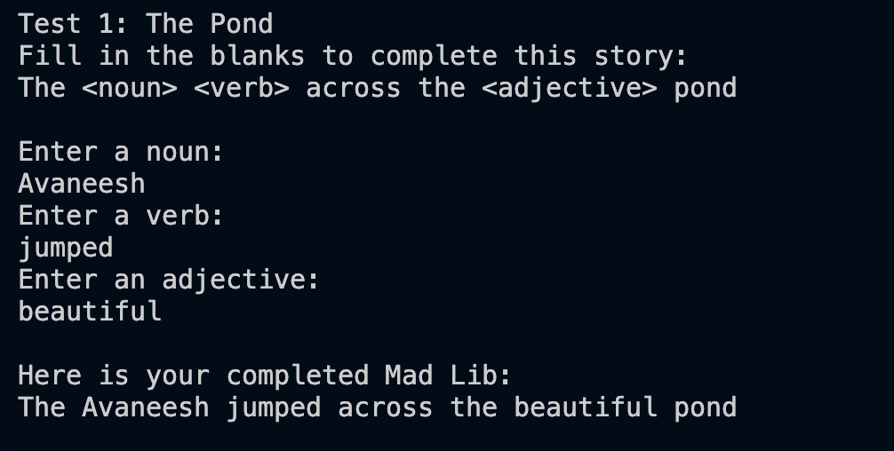
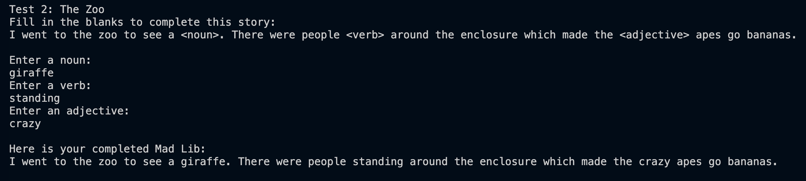
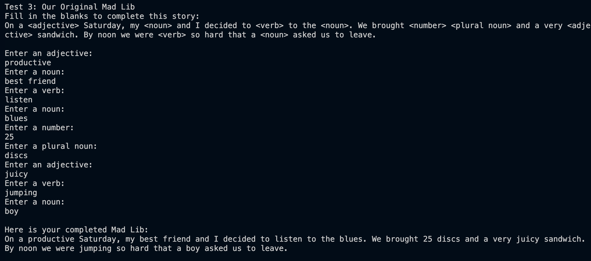

# Project 1.2.10 Mad Libs

## What it does
The program fills in Mad Lib stories with words the user types. It runs three stories in one run. For each one it prints the original story with its blanks, asks for a word for each blank, then prints the completed story.

## Approach
We split the program into small methods so each person could build and test one piece on their own fork. The PM reviewed every pull request before merging it, and Person 1 wired the pieces together.

`buildStory` walks through the story one tag at a time:
1. `findTagStart` finds the next `<`, and `findTagEnd` finds the `>` that closes it.
2. `getSection` adds the plain story text between the last tag and this one.
3. `getPartOfSpeech` reads the word type inside the brackets, such as `noun` or `plural noun`.
4. `promptUser` asks the user for a word of that type and returns their answer, which gets added to the story.
5. The search starts again just after the `>`. When there are no tags left, `getRemainder` adds the rest of the story.

`main` creates one `Scanner`, stores the three incomplete Mad Libs in variables, and sends each through `buildStory`.

| Method | Owner | What it does |
|---|---|---|
| `findTagStart(story, from)` | Person 2 | Index of the next `<` at or after `from`, or -1 if none are left |
| `findTagEnd(story, from)` | Person 2 | Index of the next `>` at or after `from`, or -1 |
| `getPartOfSpeech(story, start, end)` | Person 2 | Text between `<` and `>`, so multi-word tags like `<plural noun>` work |
| `getSection(story, from, tagStart)` | Person 3 | Story text from `from` up to the next tag |
| `getRemainder(story, from)` | Person 3 | Story text after the last tag |
| `promptUser(in, partOfSpeech)` | Person 4 | Prints a prompt ("Enter a noun:" / "Enter an adjective:") and returns the user's word |
| `buildStory(in, story)` | Person 1 | Loops over every tag and returns the completed story |
| `main` | Person 1 | Creates the Scanner and runs all three stories |

All parsing uses only String methods from the AP CSA Java Quick Reference (`indexOf`, `substring`, `length`, `equals`). `promptUser` picks "a" or "an" by checking whether the first letter of the part of speech is in `"aeiouAEIOU"`.

## Assignments

### Project Manager
- Review every person's code before it is merged: correct logic, camelCase, comments describing the algorithm, and in collaboration with Person 5
- Notify if any fixes are required.
- End to end testing.
- Own the **milestones**: create the milestone list (GitHub Project board or a table in the repo README) with estimated vs. actual time for each person's piece, and keep it updated.

### Person 1: Lead Developer / Program Structure
- Create `LastName_MadLibs.java` with the class header and `main` (requirements: class header, main, camelCase).
- Declare the variable holding the incomplete Mad Lib. Store the three test Mad Libs (see "Test runs" below), and write the third one (original, at least 7 blanks, nouns, verbs and adjectives).
- Create the single `Scanner` in `main` and pass it to `promptUser`.
- Write `buildStory` (the story generation function): the main loop that calls everyone's methods and returns the completed story, with no limit on the number of tags. `main` calls it for each story. Until the others merge, code against stub methods with the agreed signatures.
- Be the connector: copy each person's merged methods into `LastName_MadLibs.java`, fix any name or signature mismatches with the owner, and delete the per-person dev files before submitting.
- `main` runs all three stories in one run (one after another, same Scanner), so a single screenshot shows all three tests.
- For each story, write an intro message, print the original incomplete story first, then the prompts, then the final print statement with the completed story.
- Done when: the program compiles and prints a full story using the stubbed methods.

### Person 2: Parsing the Parts of Speech
- Write `findTagStart`, `findTagEnd`, `getPartOfSpeech` using only `indexOf` and `substring` (requirement: algorithm to parse for the parts of speech to replace).
- Handle multi-word tags like `<plural noun>` and the "no more tags" case (return -1).
- Add comments explaining the algorithm.
- Add comments next to your code that name the requirement it meets, for example `// Requirement: parse for the parts of speech to replace` (the rubric gives points for comments that clearly indicate where requirements are met).
- Done when: given the sample stories, it returns `noun`, `plural noun`, `number` in order.

### Person 3: Parsing the Story Sections
- Write `getSection` and `getRemainder` using `substring` and `length` (requirement: algorithm to parse for sections of the Mad Lib to include).
- Make sure no characters are lost or doubled around the tags (spaces, semicolons, periods).
- Add comments explaining the algorithm.
- Add comments next to your code that name the requirement it meets, for example `// Requirement: parse for sections of the Mad Lib to include` (the rubric gives points for comments that clearly indicate where requirements are met).
- Done when: pieces of text plus the answers stitch back together to the exact original story format.

### Person 4: User Input and Prompts
- Write `promptUser` using `Scanner` (requirement: algorithm that processes user input; various prompts).
- Vary the prompt by part of speech, for example "Enter a plural noun:" and "Enter a number:". Use "an" before vowels, as in "Enter an adjective:" (use `substring(0,1)` and `equals`/`indexOf` against "aeiou").
- Add comments next to your code that name the requirement it meets, for example `// Requirement: algorithm that processes user input` (the rubric gives points for comments that clearly indicate where requirements are met).
- Done when: each part of speech gets a clear, distinct prompt and returns the user's answer.

### Person 5: Testing, Code Documentation, and Presentation
- Run incremental tests on the code, and re-test old features after each merge. Keep a bug list and report bugs to the method's owner.
- Audit the final code against the requirements checklist.
- Penalty checks: no compile errors or warnings, no leftover debug prints, no extra classes, and the class header matches the file name.
- Make sure the screenshot shows the original story and its solution for all three stories.
- Make sure the code has a header comment stating the program's purpose and how it meets the requirements, and that every algorithm is commented.
- Document the test cases: for each of the three Mad Libs, write down the inputs entered and the output produced.
- Tell the PM which tests pass and fail so the PM can verify.
- Make the slide deck and the presentation plan: summarize what each part of the program does, the most challenging parts, and who presents which part.

## Milestones
From our [milestone tracker](MadLibs%20Milestone%20Tracker.xlsx):

| # | Milestone | Owner | Done when | Status |
|---|---|---|---|---|
| M1 | Repo set up, everyone forked | PM | All 5 forks exist, signatures posted in README | Done |
| M2 | Program skeleton + stubs | P1 | MadLibs.java compiles and prints a full story using stub methods | Done |
| M3a | Tag parsing (findTagStart, findTagEnd, getPartOfSpeech) | P2 | Sample stories return noun, plural noun, number in order; -1 when no tags | Done |
| M3b | Section parsing (getSection, getRemainder) | P3 | Text + answers stitch back to the exact original format | Done |
| M3c | Prompts (promptUser) | P4 | Distinct prompt per part of speech, "a"/"an" correct | Done |
| M3d | Original Mad Lib written | P1 | 7+ blanks, uses nouns/verbs/adjectives | Done |
| M4 | All PRs reviewed and merged | PM | P2–P4 PRs pass review (logic, camelCase, requirement comments) | Done |
| M5 | Integration | P1 | Methods copied unchanged, main runs all 3 stories in one run, dev files deleted | Done |
| M6 | Testing + bug fixes | P5 + owners | All 3 tests + another team's swap pass; bug list empty | Done |
| M7 | End-to-end check + requirements audit | PM + P5 | Every requirement checked off; no warnings or debug prints | Done |
| M8 | Screenshots + submission README | P5 | Screenshots show original and completed story for all 3 | Done |
| M9 | Slides + presentation plan | P5 + all | Deck done, each person knows their part | Done |
| M10 | Submitted | PM | Repo link turned in | Not started |

## Test runs
All three stories ran one after another in a single run, using the same Scanner.

### Test 1: The Pond
`The <noun> <verb> across the <adjective> pond`

### Test 2: The Zoo
`I went to the zoo to see a <noun>. There were people <verb> around the enclosure which made the <adjective> apes go bananas.`

### Test 3: Our Original Mad Lib (9 blanks)
`On a <adjective> Saturday, my <noun> and I decided to <verb> to the <noun>. We brought <number> <plural noun> and a very <adjective> sandwich. By noon we were <verb> so hard that a <noun> asked us to leave.`

## Requirements
- [x] `main` method
- [x] camelCase names
- [x] Comments describing the algorithms, with `// Requirement:` comments marking where each requirement is met
- [x] Variables containing the incomplete Mad Libs (`story1`, `story2`, `story3` in `main`)
- [x] Only String methods from the AP CSA Java Quick Reference
- [x] Algorithm that processes user input (`promptUser`)
- [x] Algorithm to parse for the parts of speech to replace (`findTagStart`, `findTagEnd`, `getPartOfSpeech`)
- [x] Algorithm to parse for sections of the Mad Lib to include (`getSection`, `getRemainder`)
- [x] Various prompts to keep the user on track ("Enter a noun:", "Enter an adjective:", "Enter a plural noun:", ...)
- [x] Final print statement showing the completed story
- [x] Handles nouns, verbs, adjectives, numbers and plural nouns, with up to 9 substitutions in one story
- [x] Input collection function (`promptUser`) and story generation function (`buildStory`)
- [x] Tested with the two teacher Mad Libs plus an original one
